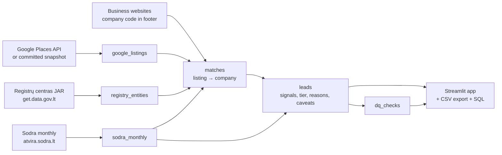

# Shadow-economy monitor (Vilnius)

Surfaces Vilnius businesses that look busy to the public but quiet on paper: many Google
reviews and long opening hours, but few insured employees in Sodra. The output is a short,
prioritised and fully explainable **and**is***or** S**te Tax Inspectorate (VMI) analyst with
limited inspection capacity.

Categories: **cofe shops**, *arepair / tyre shops**, *lor shops**.

# Quick start

Requirements: Docker (Compose v2.24+) and Git. Nothing else, no API key needed to run a sample. 
Your own Google Places API key can be added to gather newest data.

1. **Install Docker Desktop** from https://www.docker.com/products/docker-desktop/ (pick your CPU:
   Apple Silicon or Intel on Mac, AMD64 or ARM64 on Windows). For Linux, there is only one version.
2. **Start Docker** and wait until it reports it is running. The `docker` command is only set up
   after the first launch:

   | OS | Start Docker |
   |---|---|
   | macOS | `open -a Docker` (or launch Docker from Applications), wait for the menu-bar whale to say *running* |
   | Windows | Start **Docker Desktop** from the Start menu, wait for *Engine running* |
   | Linux | `sudo systemctl start docker` |

   Check: `docker compose version` should print v2.24 or newer. Give Docker at least 4 GB of memory
   (Docker Desktop: Settings > Resources).
3. **Clone and run:**

```bash
git clone https://github.com/V-Erikas/shadow-monitor.git
cd shadow-monitor
docker compose up --build
```

Open **http://localhost:8501** (type it; Safari blocks the `0.0.0.0` address some tools print).
The first run takes ~3-6 minutes (downloads ~175 MB of public data and runs the full pipeline);
later starts reuse the database and take seconds.

| Situation | What happens |
| No `.env` (clean machine) | Google data is **replayed** from the committed snapshot of a real run; registry and Sodra are downloaded fresh; matching, scoring and checks run normally |
| `GOOGLE_API_KEY` in `.env` | Fresh Google Places data is collected (≤ 900 requests, within the free tier) and saved as a new snapshot |
| Monthly run | `docker compose run --rm app python -m shadow.pipeline` adds a new run; compare it in the app |
| Re-run single steps | `... python -m shadow.pipeline --steps match score quality --run-id <run_id>` (no new Google calls) |

Every Google row records its `source` (`live` or `snapshot:<file>`), and the data quality panel
warns when Google data is older than 45 days, so a replayed run is never mistaken for fresh data.

## How it works



| Step | Module | What it does |
|---|---|---|
| 1. Google | [collect/google.py](src/shadow/collect/google.py) | Places API (New) Text Search over a Vilnius grid; dense cells split recursively (API caps at 60 results). Keeps listings whose **primary** type fits the category. Stores raw JSON |
| 2. Registry | [collect/registry.py](src/shadow/collect/registry.py) | 550k legal entities with legal form, status and dates from the data.gov.lt API |
| 3. Sodra | [collect/sodra.py](src/shadow/collect/sodra.py) | Monthly insured persons, average wage and activity code (EVRK 2.1) for all of Lithuania, current + previous year |
| 4. Matching | [match.py](src/shadow/match.py), [collect/websites.py](src/shadow/collect/websites.py) | Listing → company code (see below) |
| 5. Scoring | [score.py](src/shadow/score.py) | Three signals, tiers, exclusions, reasons and caveats |
| 6. Quality | [quality.py](src/shadow/quality.py) | 24 checks with severities, stored per run |
| UI | [app/streamlit_app.py](app/streamlit_app.py) | Leads with evidence drill-down, overview, run comparison, read-only SQL |

### Matching a listing to a legal entity

Layered, with an explicit confidence per decision; below **0.8** a listing is never scored.

| Evidence | Confidence |
|---|---|
| Company code on the business website **and** fuzzy name match agree | 0.99 |
| Labelled code ('įmonės kodas') on home / contacts / privacy / terms page, same activity code | 0.98 |
| Labelled code, company has no Sodra record (declares nobody) | 0.90 |
| Exact normalised name + matching activity code, no competing candidate | 0.90 |
| Labelled code, related activity (e.g. coffee chain run by a retailer) | 0.85 |
| Close name (≥ 92) + matching activity code, clear margin over runner-up | 0.82 |
| Code from an unrelated industry (web developer, news site), website/name conflict, ambiguous or same name shared by several companies | < 0.8 → unmatched, reason stored |

Website scans respect 'robots.txt', fetch at most 3 sub-pages, skip social/delivery platforms and
are cached in [snapshots/websites.jsonl.gz](snapshots/websites.jsonl.gz) for 90 days.

### Scoring a company

| Signal | Rule |
|---|---|
| **Staffing gap** | Robust (Huber) log-log model fitted on matched companies: insured employees vs. review volume, per category. Compares declared staff (max of last 3 months, benefit of the doubt) with what peers declare |
| **Opening hours** | Weekly hours ÷ 40 = minimum full-time staff to keep one person on site, vs. declared staff + 1 owner allowance |
| **Low wage** | Average wage vs. Vilnius category median; only available with ≥ 3 insured (Sodra hides it otherwise) |

| Tier | Rule |
|---|---|
| **multiple signals** (flagged) | ≥ 2 strong signals |
| **staffing gap only** (flagged) | Declared staff ≤ ~¼ of peer level; thinner evidence, labelled as such |
| **watchlist** | One strong signal; context, not a lead |

Never flagged: below the review floor (100 coffee / 50 others), bankruptcy or liquidation,
company younger than 12 months, listing not confidently matched. Score = weighted signals × match
confidence, so uncertain matches rank lower.

Every lead row stores **which listings** (place_id, name, Maps link), **which official records**
(company code, activity code, Sodra month) and **why** (reasons + caveats such as "MB: owners may
work uninsured", "matched by name only", "flower shops are seasonal").

---

## Results of the committed real run

Run `20261025T221813Z`, output in [output/leads_20261025T221813Z.csv](output/leads_20261025T221813Z.csv).

| | Car repair / tyres | Coffee shops | Flower shops | Total |
|---|---|---|---|---|
| Google listings | 658 | 201 | 154 | 1,013 |
| Matched to a company (≥ 0.8) | 282 | 79 | 48 | 409 |
| Companies scored | 250 | 26 | 32 | 308 |
| Eligible | 116 | 18 | 14 | 148 |
| **Flagged** | **3** | 0 | 0 | **3** |
| Watchlist | | | | 12 |

- Name matching agrees with website company codes in **93 of 99** cases (94%).
- Staffing model fitted on 289 companies; review elasticity of staff is only 0.23.
- All 24 data quality checks passed.

Example lead (anonymised): a car service MB with 55 reviews and 84 opening hours/week that
reported **no insured persons to Sodra in 12 months**, where peers with similar volume declare ~6.
Caveat shown: *Mažoji bendrija, owners may work without being insured employees.*

---

## Using the app

| Tab | Purpose |
|---|---|
| **Leads** | Filter by category, tier, match confidence; select a row for reasons, caveats, signal strengths, Google listings with Maps links, match evidence (method, page where the code was found) and Sodra history; download CSV |
| **Overview** | Flagged share per category, exclusion and non-match reasons, data freshness, map, data quality checks |
| **Compare runs** | New / persisting / dropped leads between monthly runs |
| **SQL** | Read-only DuckDB with external access disabled; example questions included |

Example follow-up question without re-running anything:

```sql
SELECT category,
       count(*) FILTER (WHERE flagged)                  AS n_flagged,
       count(*) FILTER (WHERE exclusion_reason IS NULL) AS n_eligible,
       round(n_flagged / nullif(n_eligible, 0), 3)      AS flagged_share
FROM leads WHERE run_id = (SELECT max(run_id) FROM leads)
GROUP BY 1 ORDER BY flagged_share DESC;
```

Tables: `runs`, `google_listings`, `registry_entities`, `sodra_monthly`, `matches`, `leads`, `dq_checks`
(see [db.py](src/shadow/db.py)). Everything run-specific is keyed by `run_id`.

## Development

```bash
python3.12 -m venv .venv && source .venv/bin/activate   # Windows: .venv\Scripts\Activate.ps1
pip install -r requirements.txt
export PYTHONPATH=src                                    # Windows: $env:PYTHONPATH = "src"
pytest                                                   # 57 tests, no network needed
python -m shadow.pipeline                                # full run
streamlit run app/streamlit_app.py --server.address localhost
```

Project layout:

```
src/shadow/          pipeline, config, db schema, matching, scoring, quality
src/shadow/collect/  google, registry, sodra, websites, download helper
app/                 Streamlit analyst app
snapshots/           committed Google snapshot + website scan cache (replayed without a key)
output/              example lead list from a real run (DuckDB file is not committed)
tests/               unit tests with fixtures
```

## Data sources

| Source | Data | Access |
|---|---|---|
| Google Places API (New) | Listings, reviews, rating, opening hours, website | Official API, API key |
| Registrų centras via [get.data.gov.lt](https://get.data.gov.lt/datasets/gov/rc/jar) | Legal entities, forms, statuses | Open data API |
| [atvira.sodra.lt](https://atvira.sodra.lt/imones/rinkiniai/index.html) | Monthly insured persons, wages, activity codes | Open data downloads |
| Business websites | Published company codes | Polite scraping, robots.txt respected |

See [DECISIONS.md](DECISIONS.md) for design decisions, rejected alternatives and known limitations.
